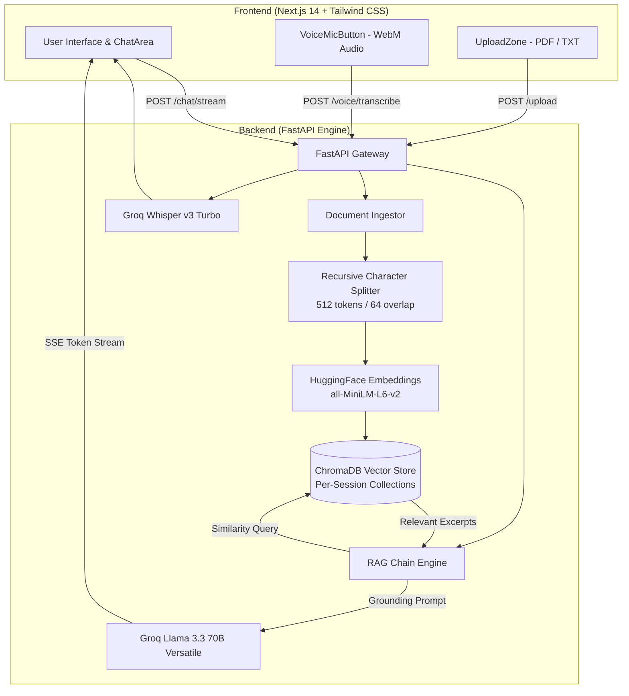

# 🌉 MindBridge

<p align="center">
  <strong>High-Precision Local-Embedding Document RAG Assistant with Hardware-Accelerated Streaming</strong>
</p>

<p align="center">
  
  
  
  
  
  
  
</p>

---

## 📖 Overview

**MindBridge** is an AI-powered study and document research assistant built on a grounded Retrieval-Augmented Generation (RAG) architecture. It allows users to upload documents (PDFs, text files) and conduct interactive conversations with precise source citations, real-time token streaming, and voice input.

Unlike generic RAG prototypes that hallucinate when questions exceed source material, MindBridge enforces a **two-layer hallucination guardrail** and runs **100% local embeddings** so your document vectors never incur API charges or leak data.

---

## ⚡ Key Highlights

- 🛡️ **Two-Layer Anti-Hallucination Guardrail**:
  1. *Empty-Retrieval Short-Circuit*: If vector search yields no relevant excerpts, query execution immediately halts without invoking the LLM.
  2. *LLM Sentinel Prefix*: Llama 3.3 70B runs at `temperature=0` with strict negative constraints. If information is absent, it responds with `NOT IN DOCUMENT —`, triggering visual refusal cues in the UI.
- 🚀 **Hardware-Accelerated LPU Streaming**: Powered by Groq's LPUs delivering near-instant token streaming via Server-Sent Events (SSE).
- 🔒 **Zero-Cost Local Embeddings**: Uses `sentence-transformers/all-MiniLM-L6-v2` running locally on CPU. No third-party API keys or embedding quotas required.
- 🎙️ **Voice Query Mode**: Integrated browser audio capture piped directly to Groq's `whisper-large-v3-turbo` for voice-to-text queries.
- 🧩 **Per-Session Isolation**: Every browser session receives an isolated ChromaDB collection (`mindbridge_{session_id}`), preventing cross-document data contamination.
- 🎯 **Dynamic $k$ Retrieval**: Intelligently scales retrieval context based on document length:
  $$\text{Chunks } k = \max(3, \min(10, \text{total} // 10 + 3))$$

---

## 🏗️ Architecture



---

## 📁 Repository Structure

```plaintext
MindBridge/
├── backend/                    # FastAPI RAG Backend
│   ├── chroma_store/           # Persistent local ChromaDB storage
│   ├── config.py               # Centralized configuration & settings
│   ├── ingestor.py             # PDF/TXT loader, chunker, & vector store manager
│   ├── main.py                 # FastAPI endpoints (SSE chat, upload, voice)
│   ├── rag_chain.py            # LangChain Groq pipeline & hallucination guardrails
│   ├── requirements.txt        # Python dependency manifest
│   └── .env.example            # Backend environment template
├── frontend/                   # Next.js 14 Web Application
│   ├── app/                    # Next.js App Router
│   │   ├── api-client.ts       # Typed API client for upload, SSE chat, & voice
│   │   ├── globals.css         # Tailwind and base styling
│   │   ├── layout.tsx          # Root page layout
│   │   └── page.tsx            # Main application layout coordinator
│   ├── components/             # Modular React UI Components
│   │   ├── ChatArea.tsx        # Message thread & composer area
│   │   ├── MessageBubble.tsx   # Message rendering with source badges
│   │   ├── Sidebar.tsx         # Ingestion manager & session controls
│   │   ├── SourceBadges.tsx    # Page reference tags
│   │   ├── Spinner.tsx         # Streaming indicator
│   │   ├── UploadZone.tsx      # Drag-and-drop document uploader
│   │   └── VoiceMicButton.tsx  # MediaRecorder speech-to-text button
│   ├── next.config.js          # Next.js configuration & dynamic proxy rewrites
│   └── package.json            # Frontend scripts & dependencies
├── DECISIONS.md                # In-depth architectural trade-off documentation
└── .gitignore                  # Git ignore rules for Python, Node, & stores
```

---

## 🚀 Getting Started

### Prerequisites

- **Python** 3.10 or 3.11
- **Node.js** 18.x or newer
- **Groq API Key**: Free at [console.groq.com/keys](https://console.groq.com/keys)

---

### 1. Backend Setup

```bash
cd backend

# Create and activate virtual environment
python -m venv venv

# Windows:
.\venv\Scripts\activate
# macOS/Linux:
source venv/bin/activate

# Install dependencies
pip install -r requirements.txt

# Configure your API key
cp .env.example .env
# Open .env and set your GROQ_API_KEY

# Start backend server (runs on http://localhost:8000)
uvicorn main:app --reload --host 0.0.0.0 --port 8000
```

> **API Documentation**: Once running, view interactive Swagger docs at [http://localhost:8000/docs](http://localhost:8000/docs).

---

### 2. Frontend Setup

In a new terminal window:

```bash
cd frontend

# Install dependencies
npm install

# Start Next.js development server
npm run dev
```

Open [http://localhost:3000](http://localhost:3000) in your browser.

---

## 📡 API Endpoints

| Method | Endpoint | Description | Request / Payload |
| :--- | :--- | :--- | :--- |
| `GET` | `/health` | Server and document readiness check | `?session_id=<id>` |
| `POST` | `/upload` | Ingest PDF or TXT into ChromaDB vector store | `multipart/form-data` (`file`) |
| `POST` | `/chat/stream` | Stream RAG answer via Server-Sent Events (SSE) | `{"question": "...", "session_id": "..."}` |
| `POST` | `/chat/reset` | Clear conversation history for session | `{"session_id": "..."}` |
| `POST` | `/voice/transcribe` | Transcribe audio via Groq Whisper v3 Turbo | `multipart/form-data` (`audio`) |

---

## 📐 Architectural Decisions

For full details on chunk size evaluation, retrieval benchmarking, and why Groq Llama 3.3 70B was chosen over Gemini Flash, please read the complete [DECISIONS.md](file:///d:/MindBridge/DECISIONS.md).

---

## 📄 License

This project is licensed under the [MIT License](LICENSE).
